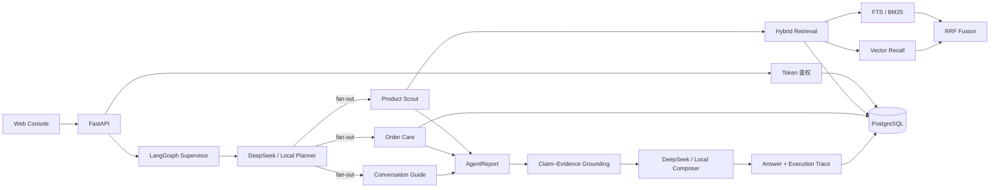
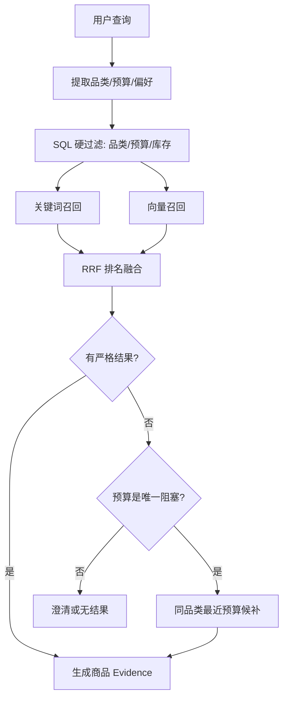

# 系统架构与关键设计

## 1. 总体架构



## 2. 一次请求的执行链路

1. FastAPI 校验 Bearer Token，并解析当前用户。
2. Repository 校验会话归属，读取最近对话和用户偏好。
3. Planner 将消息拆成一个或多个 `Mission`。
4. LangGraph 使用 `Send` 将 Mission 并发分发给领域 Agent。
5. Agent 只通过 Repository 或检索器获得业务事实，输出标准化 `AgentReport`。
6. Grounding 逐条核对 Claim 引用的 Evidence、字段和值。
7. Composer 只消费通过校验的报告；模型失败时返回本地确定性答案。
8. 回答、Evidence 和执行 Trace 返回前端，并持久化会话。

## 3. 核心数据契约

```text
Mission
  ├─ role
  ├─ instruction
  └─ parameters

AgentReport
  ├─ message
  ├─ evidence[]
  ├─ claims[]
  ├─ elapsed_ms
  └─ status

TurnResponse
  ├─ answer
  ├─ reports[]
  └─ trace
```

领域 Agent 不共享可变内部对象，而是通过这些契约与 Supervisor 通信，便于测试、并发执行和故障隔离。

## 4. 检索设计



设计原则：

- 品类、预算和库存是硬约束，相关性排序不得突破。
- 场景、品牌和关注点属于软特征，用于召回和排序。
- 两个检索通道使用相同的过滤候选集，避免向量通道绕过约束。
- 候补商品明确标记 `near_miss`，不会伪装为满足预算的结果。

## 5. Grounding 设计

每条商品、订单和政策事实都通过 `Claim` 指向一个 Evidence：

```text
Claim.evidence_reference → Evidence.reference
Claim.attribute          → Evidence.attributes 中的字段
Claim.expected_value     → Evidence 中的真实值
```

任何引用缺失、字段缺失或值不一致都会产生 Grounding Issue，对应 Agent 报告不会进入最终回答。该机制约束的是业务事实，不把语言流畅度误当成事实正确性。

## 6. 数据与安全边界

- 密码使用带随机盐的 PBKDF2-SHA256 哈希，不保存明文。
- Token 包含用户标识和过期时间，并使用 HMAC-SHA256 签名。
- 订单查询同时校验订单归属；会话首次使用时绑定用户。
- PostgreSQL 运行时只执行 Repository 查询，不调用 `create_all()` 修改正式结构。
- Alembic 负责可审计的升级和回滚。

## 7. 故障降级

| 故障 | 处理方式 |
|---|---|
| DeepSeek 未配置或超时 | 使用本地 Planner/Composer |
| 模型返回非法 JSON | Pydantic 校验失败后本地降级 |
| Claim 无法通过 Grounding | 丢弃对应 Agent 报告 |
| 某个并发 Agent 失败 | 保留其他有效分支 |
| 宽泛商品请求 | 追问品类、预算或场景 |
| 严格约束无结果 | 仅在可解释时提供候补 |

## 8. 目录职责

| 模块 | 职责 |
|---|---|
| `orchestrator.py` | LangGraph 状态、fan-out、汇合与请求入口 |
| `planning.py` | DeepSeek 结构化规划和本地规则降级 |
| `agents.py` | 三个领域 Agent 的工具调用和报告生成 |
| `retrieval.py` | 关键词/向量双通道及 RRF 融合 |
| `personalization.py` | 偏好合并和本轮显式约束优先级 |
| `grounding.py` | Claim–Evidence 一致性校验 |
| `answering.py` | 证据化回答生成与本地降级 |
| `database.py` | SQLAlchemy 表结构和 Repository |
| `api.py` | HTTP、鉴权依赖与接口契约 |
